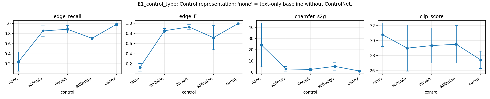
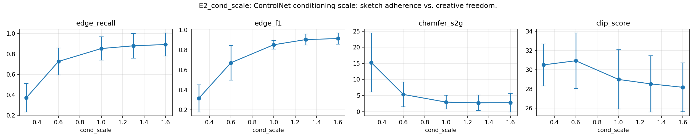
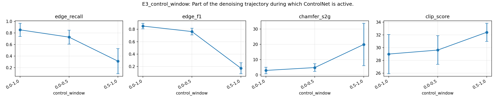
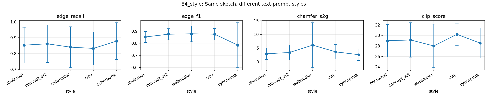
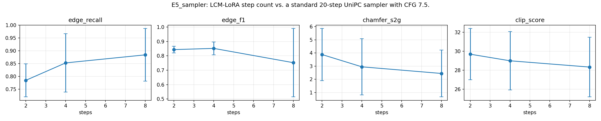
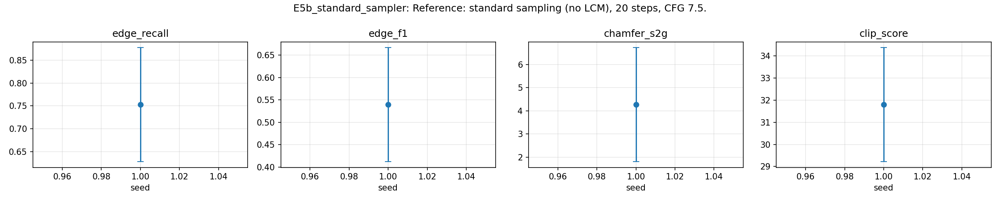
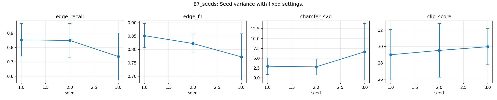
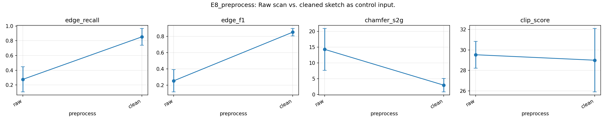

# Experiment summary

Mean ± std over all sketches and seeds. edge_recall / edge_f1: higher = sketch better preserved; chamfer_s2g (px at 512): lower = better; clip_score: higher = closer to the prompt.

## E1_control_type

Control representation; 'none' = text-only baseline without ControlNet.

| control   | edge_recall   | edge_f1       | chamfer_s2g     | clip_score     |   sec/img |
|:----------|:--------------|:--------------|:----------------|:---------------|----------:|
| none      | 0.241 ± 0.191 | 0.131 ± 0.078 | 24.362 ± 19.462 | 30.765 ± 1.578 |     66.51 |
| scribble  | 0.853 ± 0.114 | 0.852 ± 0.045 | 2.945 ± 2.132   | 28.995 ± 3.090 |    114.07 |
| lineart   | 0.886 ± 0.074 | 0.928 ± 0.046 | 2.485 ± 0.957   | 29.337 ± 2.336 |     87.74 |
| softedge  | 0.706 ± 0.149 | 0.716 ± 0.237 | 5.244 ± 3.507   | 29.507 ± 2.484 |     75.19 |
| canny     | 0.985 ± 0.026 | 0.991 ± 0.014 | 1.119 ± 0.267   | 27.425 ± 1.145 |    136.03 |

Edge F1 per sketch:

| sketch              |   none |   scribble |   lineart |   softedge |   canny |
|:--------------------|-------:|-----------:|----------:|-----------:|--------:|
| 01_futuristic_tower |  0.201 |      0.908 |     0.904 |      0.656 |   0.998 |
| 02_robot_character  |  0.191 |      0.883 |     0.963 |      0.776 |   0.998 |
| 03_hover_car        |  0.041 |      0.798 |     0.878 |      0.335 |   0.997 |
| 04_desk_lamp        |  0.053 |      0.819 |     0.904 |      0.919 |   0.997 |
| 05_floating_island  |  0.17  |      0.85  |     0.988 |      0.895 |   0.967 |

## E2_cond_scale

ControlNet conditioning scale: sketch adherence vs. creative freedom.

|   cond_scale | edge_recall   | edge_f1       | chamfer_s2g    | clip_score     |   sec/img |
|-------------:|:--------------|:--------------|:---------------|:---------------|----------:|
|          0.3 | 0.372 ± 0.139 | 0.315 ± 0.136 | 15.273 ± 9.163 | 30.514 ± 2.183 |     98    |
|          0.6 | 0.727 ± 0.131 | 0.671 ± 0.173 | 5.338 ± 3.849  | 30.942 ± 2.891 |    121.91 |
|          1   | 0.853 ± 0.114 | 0.852 ± 0.045 | 2.945 ± 2.132  | 28.995 ± 3.090 |    114.07 |
|          1.3 | 0.880 ± 0.121 | 0.903 ± 0.056 | 2.722 ± 2.409  | 28.530 ± 2.929 |    693.71 |
|          1.6 | 0.892 ± 0.112 | 0.914 ± 0.055 | 2.769 ± 2.894  | 28.175 ± 2.539 |    166.44 |

Edge F1 per sketch:

| sketch              |   0.3 |   0.6 |   1.0 |   1.3 |   1.6 |
|:--------------------|------:|------:|------:|------:|------:|
| 01_futuristic_tower | 0.264 | 0.807 | 0.908 | 0.931 | 0.938 |
| 02_robot_character  | 0.413 | 0.748 | 0.883 | 0.939 | 0.973 |
| 03_hover_car        | 0.127 | 0.381 | 0.798 | 0.957 | 0.947 |
| 04_desk_lamp        | 0.477 | 0.776 | 0.819 | 0.826 | 0.866 |
| 05_floating_island  | 0.296 | 0.644 | 0.85  | 0.864 | 0.844 |

## E3_control_window

Part of the denoising trajectory during which ControlNet is active.

| control_window   | edge_recall   | edge_f1       | chamfer_s2g     | clip_score     |   sec/img |
|:-----------------|:--------------|:--------------|:----------------|:---------------|----------:|
| 0.0-1.0          | 0.853 ± 0.114 | 0.852 ± 0.045 | 2.945 ± 2.132   | 28.995 ± 3.090 |    114.07 |
| 0.0-0.5          | 0.727 ± 0.121 | 0.763 ± 0.052 | 4.815 ± 2.544   | 29.620 ± 2.252 |     69.91 |
| 0.5-1.0          | 0.311 ± 0.216 | 0.173 ± 0.088 | 19.935 ± 13.843 | 32.419 ± 1.418 |     70.03 |

Edge F1 per sketch:

| sketch              |   0.0-1.0 |   0.0-0.5 |   0.5-1.0 |
|:--------------------|----------:|----------:|----------:|
| 01_futuristic_tower |     0.908 |     0.836 |     0.214 |
| 02_robot_character  |     0.883 |     0.74  |     0.262 |
| 03_hover_car        |     0.798 |     0.794 |     0.06  |
| 04_desk_lamp        |     0.819 |     0.702 |     0.099 |
| 05_floating_island  |     0.85  |     0.744 |     0.232 |

## E4_style

Same sketch, different text-prompt styles.

| style       | edge_recall   | edge_f1       | chamfer_s2g   | clip_score     |   sec/img |
|:------------|:--------------|:--------------|:--------------|:---------------|----------:|
| photoreal   | 0.853 ± 0.114 | 0.852 ± 0.045 | 2.945 ± 2.132 | 28.995 ± 3.090 |    114.07 |
| concept_art | 0.862 ± 0.118 | 0.874 ± 0.046 | 3.406 ± 2.747 | 29.135 ± 3.307 |     72.63 |
| watercolor  | 0.841 ± 0.130 | 0.878 ± 0.065 | 6.098 ± 8.219 | 27.997 ± 4.131 |     72.88 |
| clay        | 0.832 ± 0.105 | 0.875 ± 0.047 | 3.636 ± 2.639 | 30.211 ± 2.102 |     74    |
| cyberpunk   | 0.879 ± 0.117 | 0.784 ± 0.185 | 2.609 ± 2.151 | 28.552 ± 2.858 |     75.64 |

Edge F1 per sketch:

| sketch              |   photoreal |   concept_art |   watercolor |   clay |   cyberpunk |
|:--------------------|------------:|--------------:|-------------:|-------:|------------:|
| 01_futuristic_tower |       0.908 |         0.866 |        0.923 |  0.922 |       0.841 |
| 02_robot_character  |       0.883 |         0.916 |        0.92  |  0.873 |       0.928 |
| 03_hover_car        |       0.798 |         0.927 |        0.792 |  0.923 |       0.461 |
| 04_desk_lamp        |       0.819 |         0.825 |        0.822 |  0.824 |       0.82  |
| 05_floating_island  |       0.85  |         0.837 |        0.931 |  0.832 |       0.873 |

## E5_sampler

LCM-LoRA step count vs. a standard 20-step UniPC sampler with CFG 7.5.

|   steps | edge_recall   | edge_f1       | chamfer_s2g   | clip_score     |   sec/img |
|--------:|:--------------|:--------------|:--------------|:---------------|----------:|
|       2 | 0.785 ± 0.064 | 0.843 ± 0.023 | 3.877 ± 1.976 | 29.692 ± 2.711 |     44.83 |
|       4 | 0.853 ± 0.114 | 0.852 ± 0.045 | 2.945 ± 2.132 | 28.995 ± 3.090 |    114.07 |
|       8 | 0.884 ± 0.103 | 0.752 ± 0.237 | 2.441 ± 1.776 | 28.330 ± 3.147 |    122.38 |

Edge F1 per sketch:

| sketch              |     2 |     4 |     8 |
|:--------------------|------:|------:|------:|
| 01_futuristic_tower | 0.869 | 0.908 | 0.772 |
| 02_robot_character  | 0.862 | 0.883 | 0.934 |
| 03_hover_car        | 0.845 | 0.798 | 0.342 |
| 04_desk_lamp        | 0.814 | 0.819 | 0.83  |
| 05_floating_island  | 0.827 | 0.85  | 0.884 |

## E5b_standard_sampler

Reference: standard sampling (no LCM), 20 steps, CFG 7.5.

|   seed | edge_recall   | edge_f1       | chamfer_s2g   | clip_score     |   sec/img |
|-------:|:--------------|:--------------|:--------------|:---------------|----------:|
|      1 | 0.753 ± 0.124 | 0.539 ± 0.127 | 4.262 ± 2.459 | 31.797 ± 2.580 |    1014.5 |

Edge F1 per sketch:

| sketch              |     1 |
|:--------------------|------:|
| 01_futuristic_tower | 0.634 |
| 02_robot_character  | 0.544 |
| 03_hover_car        | 0.431 |
| 04_desk_lamp        | 0.693 |
| 05_floating_island  | 0.396 |

## E7_seeds

Seed variance with fixed settings.

|   seed | edge_recall   | edge_f1       | chamfer_s2g   | clip_score     |   sec/img |
|-------:|:--------------|:--------------|:--------------|:---------------|----------:|
|      1 | 0.853 ± 0.114 | 0.852 ± 0.045 | 2.945 ± 2.132 | 28.995 ± 3.090 |    114.07 |
|      2 | 0.849 ± 0.117 | 0.822 ± 0.036 | 2.788 ± 2.040 | 29.522 ± 3.276 |     69.29 |
|      3 | 0.737 ± 0.164 | 0.772 ± 0.086 | 6.618 ± 7.189 | 29.970 ± 2.203 |     69.84 |

Edge F1 per sketch:

| sketch              |     1 |     2 |     3 |
|:--------------------|------:|------:|------:|
| 01_futuristic_tower | 0.908 | 0.849 | 0.855 |
| 02_robot_character  | 0.883 | 0.856 | 0.765 |
| 03_hover_car        | 0.798 | 0.765 | 0.748 |
| 04_desk_lamp        | 0.819 | 0.822 | 0.645 |
| 05_floating_island  | 0.85  | 0.82  | 0.85  |

## E8_preprocess

Raw scan vs. cleaned sketch as control input.

| preprocess   | edge_recall   | edge_f1       | chamfer_s2g    | clip_score     |   sec/img |
|:-------------|:--------------|:--------------|:---------------|:---------------|----------:|
| raw          | 0.276 ± 0.170 | 0.255 ± 0.136 | 14.261 ± 6.602 | 29.526 ± 1.309 |     69.19 |
| clean        | 0.853 ± 0.114 | 0.852 ± 0.045 | 2.945 ± 2.132  | 28.995 ± 3.090 |    114.07 |

Edge F1 per sketch:

| sketch              |   raw |   clean |
|:--------------------|------:|--------:|
| 01_futuristic_tower | 0.464 |   0.908 |
| 02_robot_character  | 0.201 |   0.883 |
| 03_hover_car        | 0.097 |   0.798 |
| 04_desk_lamp        | 0.22  |   0.819 |
| 05_floating_island  | 0.291 |   0.85  |
